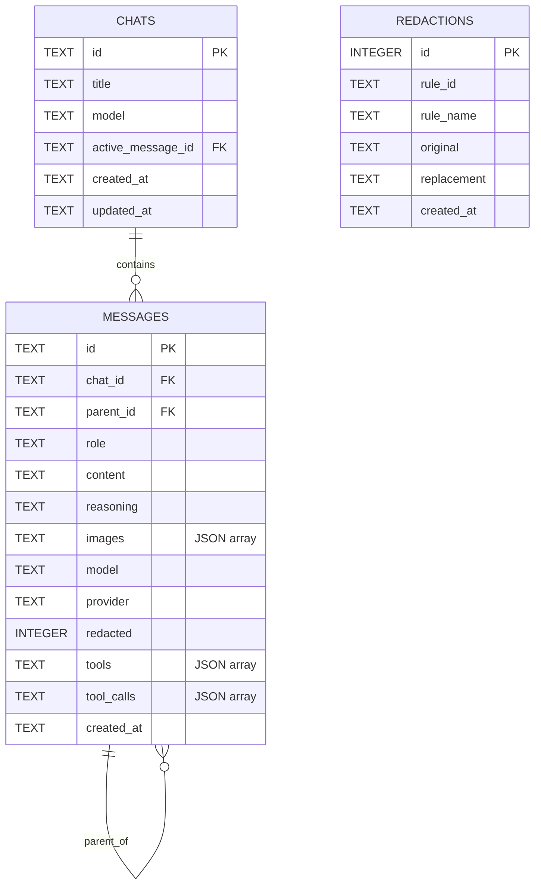
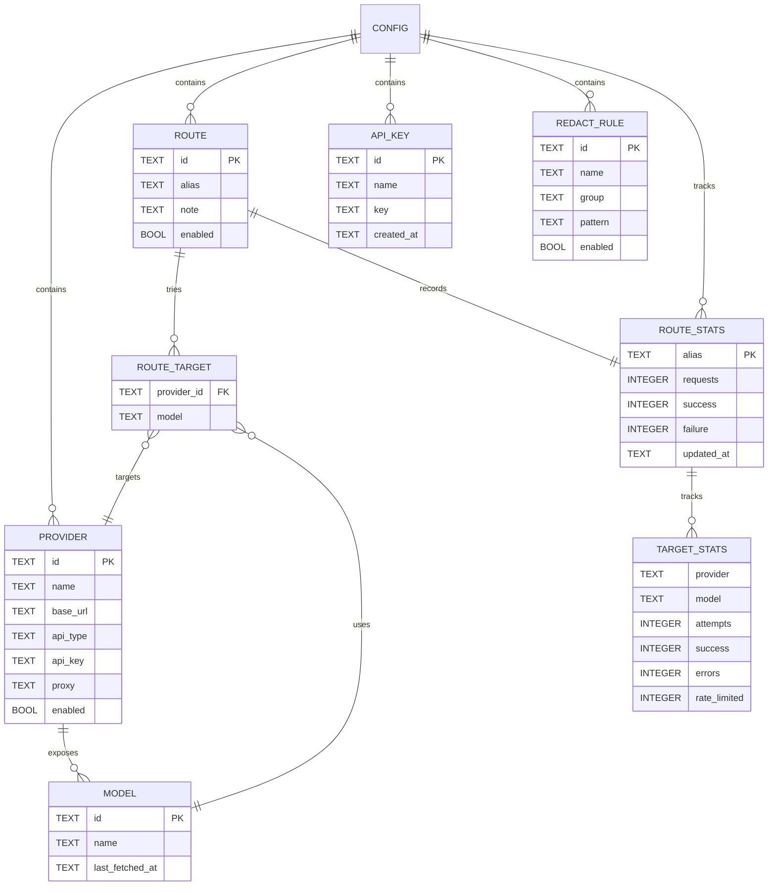

# FlashRoute Development

Build, test and release instructions for FlashRoute. For installation and usage, see [README.md](README.md).

## Requirements

The server requires Go 1.27.3+ and Node.js 22.17+. The optional desktop module uses [Wails v3](https://wails.io/).

```bash
# Build the frontend and the single server binary
make build
# Output: bin/flashroute

./bin/flashroute
# Open http://localhost:8080
```

Development mode (Vite HMR + Go backend):

```bash
make dev
# Frontend: http://localhost:5173
# Backend:  http://127.0.0.1:8080
# Vite proxies /api and /v1 to the backend
```

Custom ports or data directory:

```bash
DEV_BACKEND_PORT=8081 DEV_FRONTEND_PORT=5174 make dev
FLASHROUTE_DATA_DIR=/tmp/flashroute-dev make dev
```

Frontend edits hot-reload. Go edits trigger an automatic rebuild and backend restart; the backend log is written to `flashroute-dev-backend.log` in the temporary directory.

Install the pre-commit hook once:

```bash
pre-commit install
pre-commit run --all-files
```

The hook checks `gofmt`, runs `go vet`, `go test ./...` and builds the frontend.

## Desktop (Wails)

```bash
make frontend
make desktop
# Output: desktop/build/bin/flashroute.app
```

`make desktop` runs `wails build`. Wails embeds the same frontend and Go HTTP handler; desktop sessions are always password-free.

## Project layout

```text
cmd/flashroute/        server entry point
desktop/               optional Wails v3 desktop entry (separate Go module)
frontend/              SvelteKit frontend; build/ is embedded with go:embed
internal/config/       config data structures
internal/store/        config, stats and chat persistence
internal/gateway/      upstream requests, proxies, model tests, fallback routing
internal/server/       HTTP API, auth, gateway and static files
```

## Data model (ER)

### SQLite persistence



`messages.parent_id` is a self-reference used to build the message/version tree.
`chats.active_message_id` points at the leaf currently shown by the chat.
`redactions.rule_id` refers to a rule ID from `config.yaml`; it is not a SQLite foreign key.
The application, not SQLite constraints, enforces these relationships.

### Configuration model



Provider, route and key configuration lives in `config.yaml`; route statistics live in `stats.yaml`.
`ROUTE_TARGET.model` is a provider-specific model ID, and the pair `(provider_id, model)` must resolve to an enabled provider/model when a request is routed.

## Testing

```bash
make test
# or build the frontend first, then run Go tests
make frontend
go test ./...
```

The UI is tested in a real browser with Playwright, covering provider setup, model sync and tests, proxy tests, 429 fallback, Markdown chat, message editing and version switching, images, privacy mode, API key copying, themes, language switching and remote-password flows.

## Release

Push a semver tag to trigger the release workflow:

```bash
git tag v1.2.3
git push origin v1.2.3
```

GitHub Actions builds the frontend, cross-compiles the server binaries, builds a universal macOS DMG (`FlashRoute-desktop-mac-<version>.dmg`), uploads everything with a `SHA256SUMS` file and an `update.json` manifest to the GitHub Release, and publishes the matching npm package when the `NPM_TOKEN` repository secret (an npm automation token) is configured. The package is published as `flashroute`. Binary versions use the tag without the leading `v`, and the commit hash is embedded into the binary and shown on the Settings page.

## License

[MIT](LICENSE)
