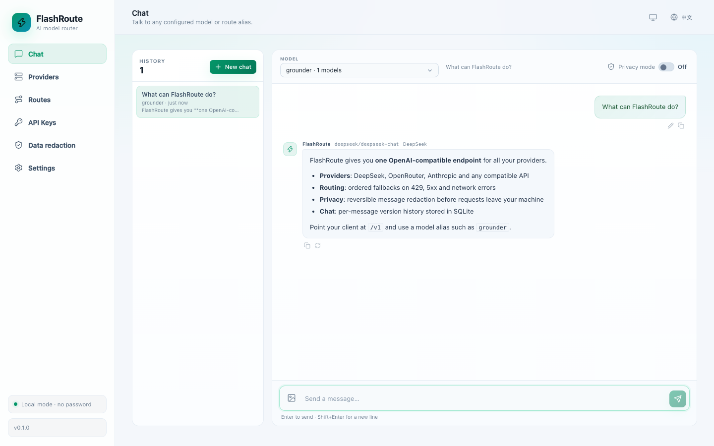

# FlashRoute

一个用 Go + SvelteKit 编写的 AI 网关和聊天控制台。聚合 DeepSeek、OpenRouter、BigModel、Anthropic 以及任意 OpenAI 兼容供应商，支持 HTTP/SOCKS 代理、模型别名顺序路由、429 自动回退、请求命中统计、客户端 API Key、可还原的消息脱敏和带图片的多模型聊天。

[English](README.md) | 简体中文



## 特性

- **多供应商聚合**：DeepSeek、OpenRouter、BigModel、Anthropic 和自定义 OpenAI 兼容接口。
- **独立代理**：每个供应商可配置 `http://`、`https://`、`socks5://` 或 `socks5h://`，并可单独测试代理连通性。
- **供应商视图与余额**：支持卡片 / 列表视图切换；DeepSeek 和 OpenRouter 可直接查询余额 / 剩余额度。
- **供应商模型**：从 `/v1/models` 同步候选模型，始终展示全部模型，点击 Chip 选择或取消；使用 `1+1=? Only output the number.` 逐模型测试，连接测试默认测试第一个模型。
- **API 类型**：每个供应商可选择 Chat Completions、Responses 或 Anthropic Messages API，网关会自动转换请求和流式响应。
- **组合路由**：例如 `grounder` 依次请求 `ds/deepseek-flash`、`aliyun/qwen3.8-27b`；429、5xx 和网络错误自动切到下一个。
- **统计**：路由请求数、成功率、每个目标命中率和 429 次数，数据持久化到 YAML。
- **客户端 Key**：自动生成 `sk-fr-` 前缀的 Key，界面默认打码显示，可一键复制完整值。
- **信息脱敏**：发送给供应商前按自定义正则替换消息中的敏感信息。默认覆盖 API Key、Bearer Token 和私钥；占位标签可逆，模型回复中的标签会自动还原。规则和全局开关都在「信息脱敏」页。
- **OpenAI 兼容网关**：`/v1/models`、`/v1/chat/completions`，支持 `stream: true`。
- **聊天界面**：流式输出、思考过程展示、文字 + 图片、Markdown 渲染、一键复制、隐私模式（不落盘）和历史会话。
- **消息版本**：修改用户消息会新增用户消息版本，重新生成 AI 回复会新增回复版本；每条消息独立显示 `当前/总数` 并支持左右切换，版本树存储在 SQLite。
- **多语言与主题**：中文 / English，暗黑 / 亮色 / 跟随系统。
- **访问控制**：localhost 和桌面版免密码；远程访问必须设置密码。反向代理场景可加 `-require-auth`。
- **独立二进制**：SvelteKit 构建产物通过 `go:embed` 打包，单个 Go 二进制即可运行。
- **桌面应用**：可选 Wails v2 桌面壳，复用同一套 Go HTTP handler 和前端。

## 同类项目 / Alternatives

FlashRoute 更偏向「单二进制、自带聊天界面、轻量自托管」；如果需要更完整的计费体系、Agent 配置管理或企业级网关，可以参考这些项目：

- [magpie](https://github.com/yetone/magpie) — 本地网关 + Agent 模型切换，支持 Claude Code / Codex 等，带隐私脱敏、路由组和订阅账户池。
- [LiteLLM](https://github.com/BerriAI/litellm) — 成熟的 Python LLM 网关 / SDK，支持大量供应商、OpenAI 兼容代理、预算与限流。
- [New API](https://github.com/QuantumNous/new-api) — 自托管 LLM 网关，渠道管理、令牌、计费和用户体系完善。
- [One API](https://github.com/songquanpeng/one-api) — OpenAI 兼容聚合网关，多供应商与令牌管理。
- [Portkey Gateway](https://github.com/Portkey-AI/gateway) — 生产级 AI 网关，支持路由、缓存、重试和 guardrails。
- [Bifrost](https://github.com/maximhq/bifrost) — Go 编写的高性能 AI 网关，多供应商回退与可观测性。
- [Envoy AI Gateway](https://github.com/envoyproxy/ai-gateway) — 基于 Envoy 的 AI 流量网关，适合 Kubernetes / 平台团队。
- [Higress](https://github.com/alibaba/higress) — 云原生 API 网关，提供 AI 代理与多模型路由能力。
- [Helicone](https://github.com/Helicone/helicone) — LLM 可观测性与代理，缓存、成本统计和实验能力。
- [OpenRouter](https://openrouter.ai) — 托管式多模型聚合服务，不是自托管项目。

## 开发与构建

服务端需要 Go 1.27.3+、Node.js 22.17+。桌面模块使用 [Wails v2](https://wails.io/)。

```bash
# 构建前端 + 单个服务端二进制
make build
# 产物：bin/flashroute

./bin/flashroute
# 打开 http://localhost:8080
```

开发模式（Vite 热更新 + Go 后端）：

```bash
make dev
# 前端：http://localhost:5173
# 后端：http://127.0.0.1:8080
# Vite 会把 /api 和 /v1 代理到后端
```

可自定义端口或数据目录：

```bash
DEV_BACKEND_PORT=8081 DEV_FRONTEND_PORT=5174 make dev
FLASHROUTE_DATA_DIR=/tmp/flashroute-dev make dev
```

前端修改会热更新；修改 Go 代码后会自动重新编译并重启后端，后端日志输出到临时目录的 `flashroute-dev-backend.log`。

安装 pre-commit 钩子：

```bash
pre-commit install
pre-commit run --all-files
```

钩子会检查 `gofmt`，运行 `go vet`、`go test ./...` 并构建前端。

### 服务端模式

```bash
./bin/flashroute \
  -listen 0.0.0.0:8080 \
  -data-dir ~/.config/flashroute
```

首次通过**远程地址**打开页面时，会要求设置密码。通过 `localhost` / `127.0.0.1` 访问时仍然免密码。使用本机反向代理时，代理进程的请求看起来来自 loopback，请加 `-require-auth`：

```bash
./bin/flashroute -listen 0.0.0.0:8080 -require-auth
```

其他参数：

```bash
./bin/flashroute -version
./bin/flashroute -listen 127.0.0.1:9000 -data-dir ./data
FLASHROUTE_DATA_DIR=/path/to/data ./bin/flashroute
```

### 桌面版（Wails）

```bash
make frontend
make desktop
# 产物：desktop/build/bin/flashroute.app
```

`make desktop` 会执行 `wails build`。Wails 使用内嵌前端和同一个 Go HTTP handler；桌面会话始终免密码。

## 数据目录

默认 `~/.config/flashroute/`：

```text
~/.config/flashroute/
├── config.yaml   # 供应商、模型、组合路由、API Key、密码哈希
├── stats.yaml    # 路由与目标命中统计
├── chats.db      # 非隐私聊天记录与消息版本树（SQLite，纯 Go）
└── uploads/      # 非隐私聊天图片
```

供应商 API Key 在 `config.yaml` 中按需求明文保存，并在前端默认打码显示，可点击复制获取完整值。文件权限为 `0600`，数据目录为 `0700`。聊天记录使用纯 Go SQLite 保存；编辑用户消息会新增用户消息版本，重新生成 AI 回复会新增回复版本，每条消息可独立前后切换。旧的 `chats.yaml` 会在启动时自动迁移为 `chats.db`。

## 使用网关

也可以直接通过 npm 运行：

```bash
npx flashroute
```

npm 包装脚本会下载对应平台的最新 release 二进制，校验 SHA-256 后透传所有参数。`flashroute -version` 会显示版本号和 git commit。

在 **API Keys** 页面创建或复制一个 `sk-fr-` Key，然后：

```bash
curl http://localhost:8080/v1/models \
  -H "Authorization: Bearer sk-fr-..."

curl http://localhost:8080/v1/chat/completions \
  -H "Authorization: Bearer sk-fr-..." \
  -H "Content-Type: application/json" \
  -d '{
    "model": "grounder",
    "messages": [{"role": "user", "content": "hello"}],
    "stream": true
  }'
```

模型名可以是：

- 组合路由别名，例如 `grounder`
- 直连模型，格式 `<provider-id>/<model-id>`，例如 `deepseek/deepseek-chat`

响应头包含实际命中的信息：

```text
X-FlashRoute-Alias
X-FlashRoute-Provider
X-FlashRoute-Model
X-FlashRoute-Attempts
```

## 项目结构

```text
cmd/flashroute/        服务端入口
desktop/               Wails 桌面入口（独立 Go module）
frontend/              SvelteKit 前端，build/ 通过 go:embed 打包
internal/config/       配置数据结构
internal/store/        配置、统计、聊天持久化
internal/gateway/      上游请求、代理、模型测试、回退路由
internal/server/       HTTP API、鉴权、网关、静态文件
```

## 测试

```bash
make test
# 或先构建前端，再运行 Go 测试
make frontend
go test ./...
```

UI 使用 Playwright 做过实际浏览器测试，覆盖供应商接入、模型同步与测试、代理测试、429 回退、Markdown 聊天、消息编辑与版本切换、图片、隐私模式、API Key 复制、主题、中英文切换及远程密码流程。

## 发布

推送 semver tag 会触发发布流程：

```bash
git tag v1.2.3
git push origin v1.2.3
```

GitHub Actions 会构建前端、交叉编译服务端二进制、生成 macOS universal DMG（`FlashRoute-desktop-mac-<version>.dmg`），连同 `SHA256SUMS` 一起上传到 GitHub Release；配置 `NPM_TOKEN` 仓库密钥（npm automation token）后，还会发布同版本的 npm 包，包名为 `flashroute`。二进制版本号使用去掉前导 `v` 的 tag，commit hash 会注入二进制并显示在设置页。

## License

[MIT](LICENSE)
